# Como usar o app

Este guia mostra o trabalho de uma semana no SB Instagram: cadastrar os produtos, montar a oferta, gerar as artes para o Instagram e o texto do comercial, e começar a oferta da semana seguinte. Ele parte do app já instalado e aberto no navegador; se ainda não estiver, siga antes a [instalação](./instalacao.md).

As telas abaixo usam os [dados de exemplo](../README.md#dados-de-exemplo) do Supermercado Baratão. Para testar o app com eles, restaure o backup de exemplo como explicado em [Configurações](#configurações).

No fim, cada arte sai assim, pronta para postar:

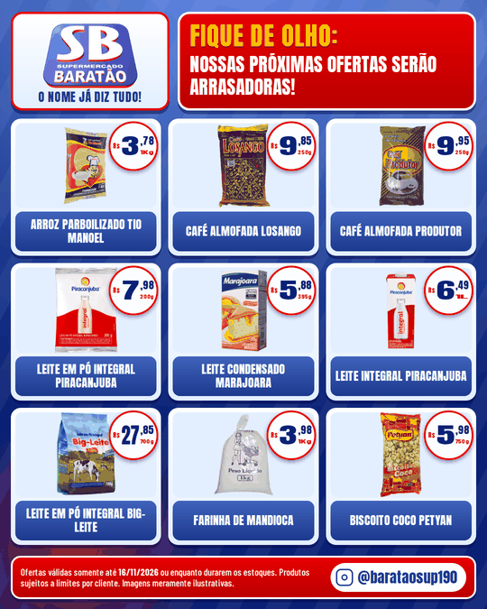

## Sumário

1. [Primeira configuração](#1-primeira-configuração)
2. [Produtos](#2-produtos)
3. [Oferta](#3-oferta)
4. [Gerar oferta](#4-gerar-oferta)
5. [Histórico](#5-histórico)
6. [Comercial](#6-comercial)
7. [A oferta da semana seguinte](#7-a-oferta-da-semana-seguinte)
8. [Configurações](#configurações)
9. [Dicas](#dicas)

## O menu

O menu no topo segue a ordem do trabalho da semana:

- **Oferta:** monta as artes da oferta atual.
- **Comercial:** o roteiro do comercial e como a voz fala cada produto.
- **Produtos:** o cadastro dos produtos do mercado.
- **Histórico:** as ofertas já geradas, com as artes, o PDF e os textos.
- **Configurações**, no canto direito: a marca do mercado e o backup.

## 1. Primeira configuração

Na primeira vez que o app é aberto, ele pede a marca do mercado, que aparece em todas as artes:

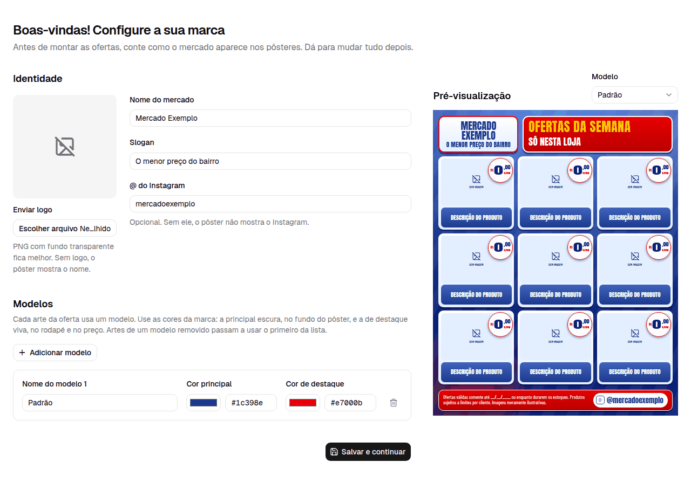

1. Preencha o **Nome do mercado**, o **Slogan** e o **@ do Instagram** (opcional).
2. Em **Enviar logo**, escolha a imagem do logo. Um PNG com fundo transparente fica melhor. Sem logo, a arte mostra o nome do mercado.
3. Em **Modelos**, escolha as cores: a **Cor principal**, escura, vai no fundo da arte, e a **Cor de destaque**, viva, vai no rodapé e no preço. Dá para digitar o código da cor (por exemplo `#1c398e`) do manual da marca. Com **Adicionar modelo**, você cria outras combinações de cores, como uma para o açougue e outra para a mercearia.
4. A **Pré-visualização**, à direita, mostra como a arte fica. Clique em **Salvar e continuar**.

Tudo isso pode ser mudado depois em **Configurações** → **Marca**.

## 2. Produtos

Cada produto é encontrado pelo **código de barras** (EAN) ou, quando não tem um, pelo **código interno** do mercado (o do caixa ou da balança). Você pode usar um leitor de código de barras USB ou digitar o código.

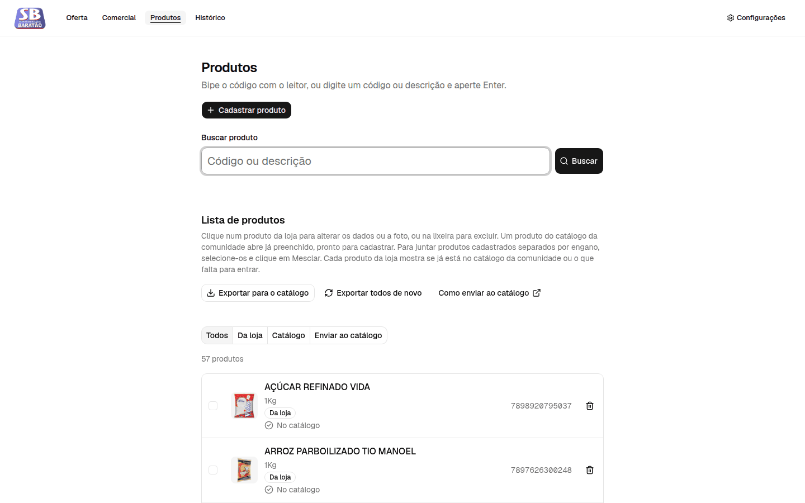

### Bipar um produto

Em **Produtos**, clique no campo **Buscar produto** e bipe o código. O leitor já aperta Enter sozinho; se digitar, aperte Enter no fim.

- **Produto já cadastrado:** abre a janela **Editar produto**, para mudar o que precisar.
- **Produto do catálogo da comunidade:** muitos produtos com código de barras já vêm com foto, descrição e unidade, prontos para usar. A janela **Cadastrar produto** abre preenchida: confira e clique em **Salvar produto**.
- **Código novo:** abre **Cadastrar produto** com o código preenchido, para você completar o resto.

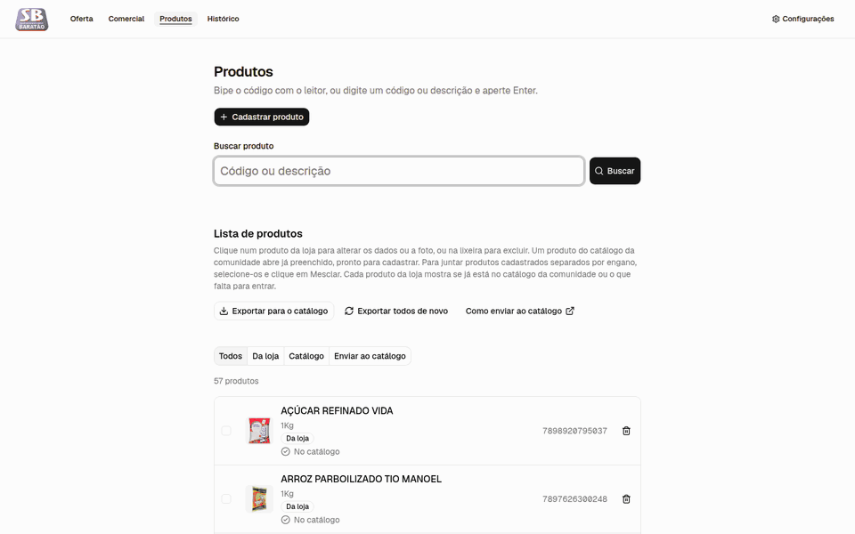

Depois de salvar, o cursor volta para o campo de busca com o aviso "Bipe o próximo código". Assim, dá para cadastrar uma pilha de produtos só bipando e salvando.

### Cadastrar um produto

Clique em **Cadastrar produto**, ou bipe um código novo, e preencha:

- **Código de barras ou código interno.**
- **Descrição:** o nome e a marca, como devem aparecer na arte (por exemplo, "CAFÉ PILÃO").
- **Unidade:** como o produto é vendido, por exemplo "1kg", "395g" ou "2L". Ela aparece junto do preço.
- **Foto:** em **Enviar foto**, escolha uma foto do produto (JPG, PNG ou WebP de até 10 MB). Para produtos sem código de barras, como carnes e frios, a janela também oferece **Ou escolha uma imagem do catálogo**.
- **Texto da locução:** como o comercial fala o produto. Clique em **Sugerir** para o app escrever por você, com números e medidas por extenso. Deixe vazio para usar sempre a sugestão (veja [Comercial](#6-comercial)).
- **Outros códigos:** quando uma foto vale para várias variações, como as fragrâncias de um sabonete, bipe aqui o código de cada uma. Bipar qualquer um deles encontra o mesmo produto.

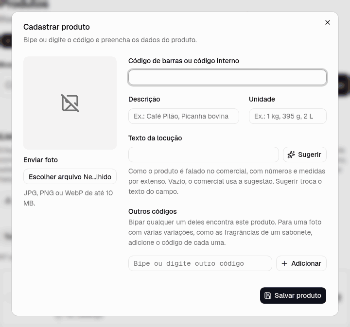

Se o código for de um produto que você já cadastrou, a janela avisa e oferece **Abrir produto cadastrado**. Para um código novo de um produto que já existe, use **Adicionar a um produto existente**, que procura o produto pela descrição e junta o código a ele.

### Editar um produto

Bipe o código, ou clique no produto na lista, para abrir **Editar produto**. Mude o que precisar e clique em **Salvar produto**. A oferta atual já mostra a mudança.

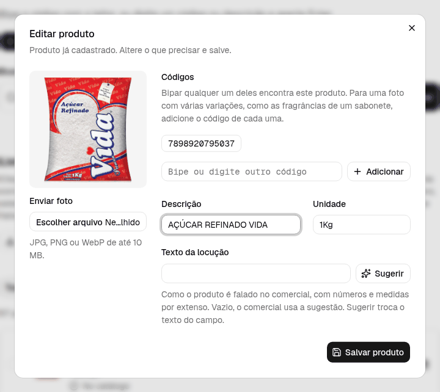

### A lista de produtos

Abaixo da busca ficam todos os produtos, em ordem alfabética: os do mercado (**Da loja**) e os do catálogo da comunidade (**Catálogo**). Digite parte da descrição no campo de busca e aperte Enter para filtrar a lista; não precisa de acento nem de maiúsculas. Os botões **Todos**, **Da loja**, **Catálogo** e **Enviar ao catálogo** filtram por origem.

Clicar num produto do catálogo abre o cadastro já preenchido, como se você tivesse bipado o código.

### Juntar produtos repetidos

Se o mesmo produto foi cadastrado duas vezes (por exemplo, uma pelo código de barras e outra pelo código interno), marque os dois na lista e clique em **Mesclar**:

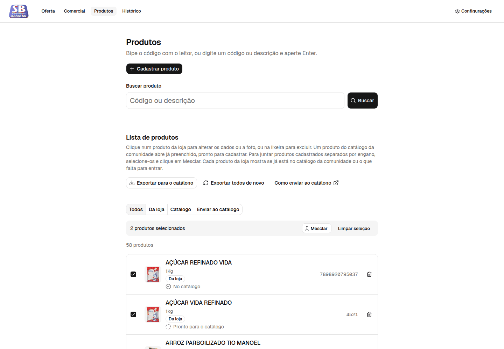

Escolha o **Produto que fica**: ele mantém a descrição, a unidade e a foto e recebe os códigos do outro, que é excluído. A janela mostra quais códigos passam para ele e se a oferta atual muda.

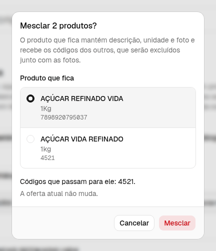

### Excluir um produto

Clique na lixeira ao lado do produto e confirme. Um produto que está na oferta atual não pode ser excluído: tire-o da oferta antes.

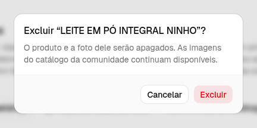

### Enviar fotos ao catálogo da comunidade

Cada produto da loja mostra se já está no catálogo da comunidade (**No catálogo**), se pode ir para ele (**Pronto para o catálogo**) ou o que falta, como **Sem foto** ou **Falta a unidade**. **Exportar para o catálogo** baixa um `.zip` com os produtos novos ou alterados, no formato do catálogo. **Como enviar ao catálogo** explica como mandar esse arquivo pelo site do GitHub. Assim, outros mercados passam a encontrar esses produtos já com foto.

## 3. Oferta

A tela **Oferta** é a oferta atual do mercado. Ela tem uma ou mais **artes** (cada arte é uma imagem do Instagram) e, à direita, a **pré-visualização** da arte aberta.

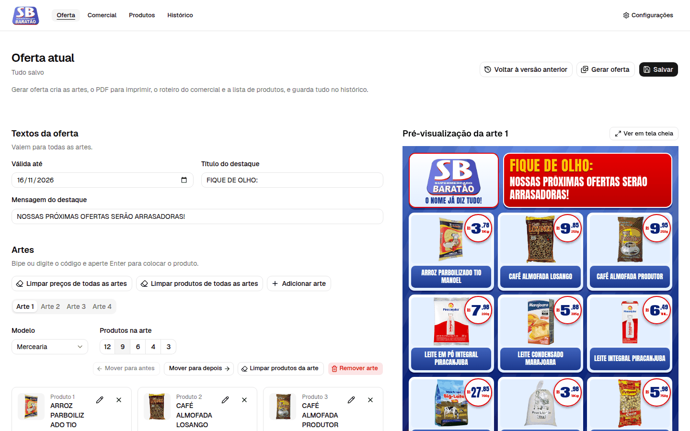

### Textos da oferta

Valem para todas as artes:

- **Válida até:** a data que aparece no rodapé.
- **Título do destaque** e **Mensagem do destaque:** o texto grande no topo da arte, ao lado do logo.

### Artes

- **Adicionar arte** cria uma arte nova, vazia. As abas **Arte 1**, **Arte 2**… trocam a arte aberta.
- **Modelo** escolhe as cores da arte (veja [Primeira configuração](#1-primeira-configuração)).
- **Produtos na arte** escolhe quantos produtos a arte mostra: 12, 9, 6, 4 ou 3.
- **Mover para antes** e **Mover para depois** mudam a ordem das artes. Essa ordem é a do comercial e a dos arquivos gerados.
- **Remover arte** apaga a arte aberta, depois de confirmar.

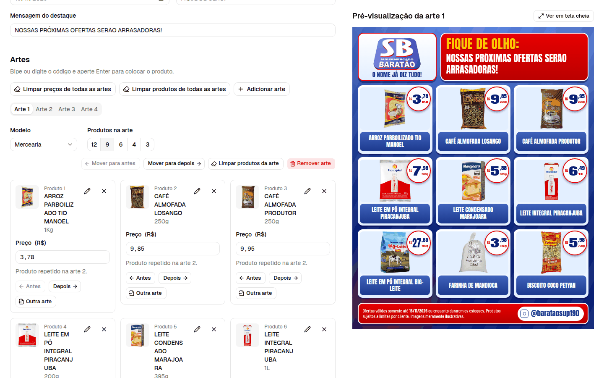

### Colocar produtos

Cada espaço da arte tem um campo **Código ou descrição**. Bipe o código, ou digite e aperte Enter, e o produto entra na arte. Depois, digite o **Preço**. A pré-visualização muda na hora.

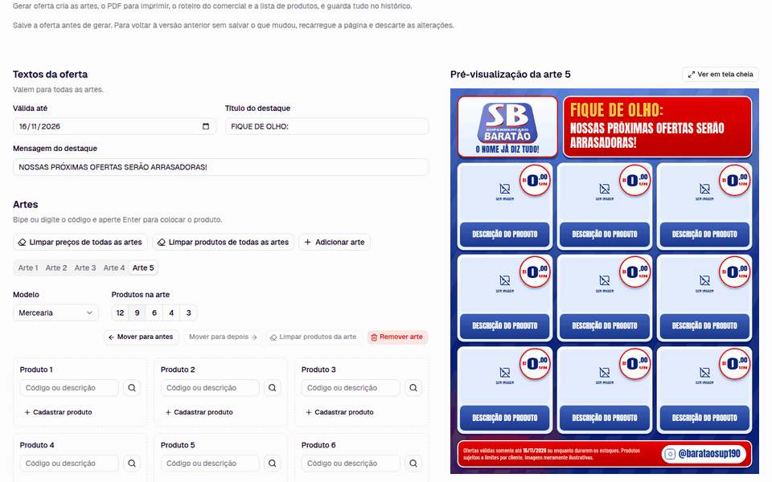

Também dá para digitar parte da descrição: o campo sugere os produtos cadastrados. Use as setas e Enter, ou clique, para escolher.

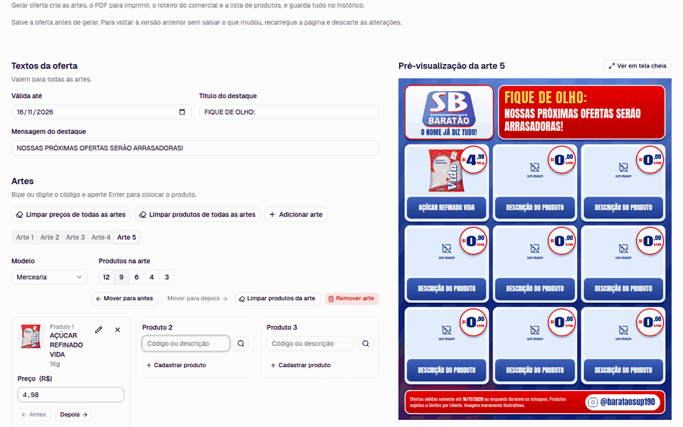

Se o produto ainda não estiver cadastrado, clique em **Cadastrar produto** no espaço: ao salvar, ele já entra na arte.

> [!TIP]
> Um produto tem o mesmo preço em toda a oferta. Se ele aparece em mais de uma arte, mudar o preço numa delas muda em todas, e o campo avisa em quais outras artes ele está ("Produto repetido na arte 2").

### Organizar os produtos

Cada produto da arte tem:

- O lápis, que abre **Editar produto** para corrigir a descrição, a unidade ou a foto.
- O **X**, que tira o produto da arte.
- **Antes** e **Depois**, que trocam o produto de lugar com o vizinho.
- **Outra arte**, que move o produto para outra arte (**Mover para**) ou coloca uma cópia dele lá (**Copiar para**), com o mesmo preço. **Arte nova** cria uma arte só para ele. Se a arte de destino estiver cheia, o app pergunta se você quer criar uma arte nova ou trocar o produto por um de lá.

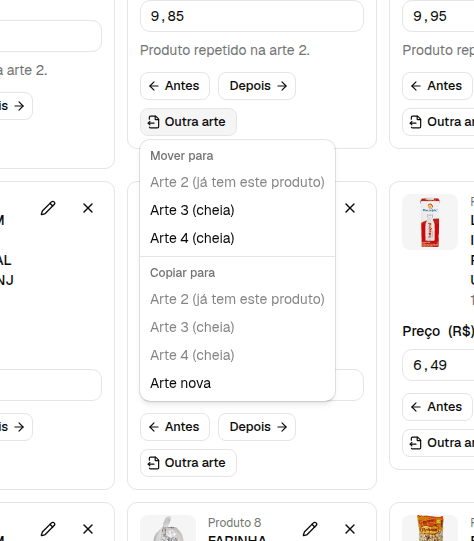

### Fora da arte

Se você diminuir a quantidade de **Produtos na arte**, os produtos que não cabem não somem: eles ficam em **Fora da arte**, abaixo dos outros, e não aparecem na arte. Use **Antes** para trazer um deles de volta, ou escolha uma quantidade maior.

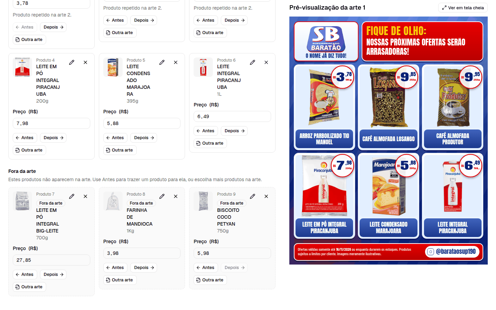

### Ver em tela cheia

**Ver em tela cheia**, acima da pré-visualização, mostra a arte grande, com botões para passar pelas artes, inclusive com o que ainda não foi salvo.

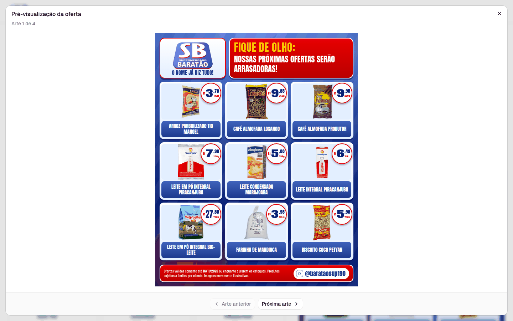

### Salvar

Clique em **Salvar**, no topo, quando terminar. Abaixo do título, a tela diz se está tudo salvo. Se você tentar sair da página, ou fechar o navegador, com alterações não salvas, o app pergunta antes.

Salvou por engano, ou limpou o que não devia? **Voltar à versão anterior** desfaz o último salvamento. A janela mostra quando aquela versão foi substituída e quantas artes e produtos voltam. Voltar de novo desfaz a volta.

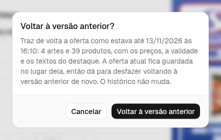

## 4. Gerar oferta

Com a oferta salva, clique em **Gerar oferta**. O app cria as artes em PNG, o PDF para imprimir, o roteiro do comercial e a lista de produtos, e guarda tudo no **Histórico**. Isso pode levar alguns segundos.

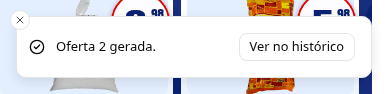

O botão fica desativado enquanto houver alterações não salvas: o que é gerado é sempre a oferta salva.

## 5. Histórico

Cada oferta gerada fica guardada no **Histórico**, numerada e com a validade, exatamente como estava ao gerar. Mudar a oferta, um produto ou a marca depois não altera o que já foi gerado.

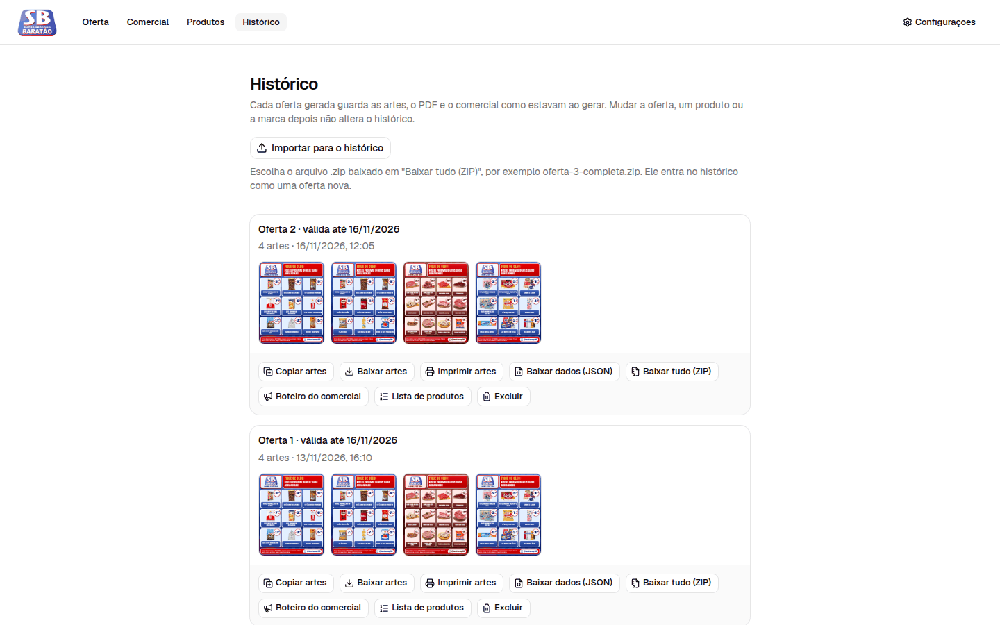

Cada oferta tem:

- **Baixar artes:** um `.zip` com as artes em PNG, prontas para postar no Instagram.
- **Imprimir artes:** abre o PDF, com uma arte por folha A4, para imprimir pelo navegador.
- **Roteiro do comercial** e **Lista de produtos:** abrem os textos para **Copiar** ou baixar. O roteiro é o texto para colar no serviço de voz; a lista numera os produtos com os preços, para quem lê ou grava o comercial.
- **Baixar dados (JSON):** os dados da oferta, para quem monta o anúncio fora do app.
- **Baixar tudo (ZIP):** tudo isso num arquivo só, que pode ser levado para o histórico de outra instalação com **Importar para o histórico**, no topo da página.
- **Copiar artes:** traz artes desta oferta de volta para a oferta atual (veja [abaixo](#7-a-oferta-da-semana-seguinte)).
- **Excluir:** apaga a oferta do histórico, depois de confirmar.

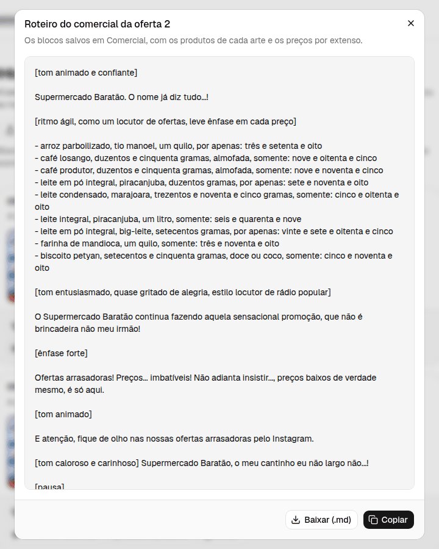

## 6. Comercial

A tela **Comercial** define o texto do comercial, gerado junto com a oferta. À direita, a **Pré-visualização** mostra o roteiro e a lista da oferta salva enquanto você edita.

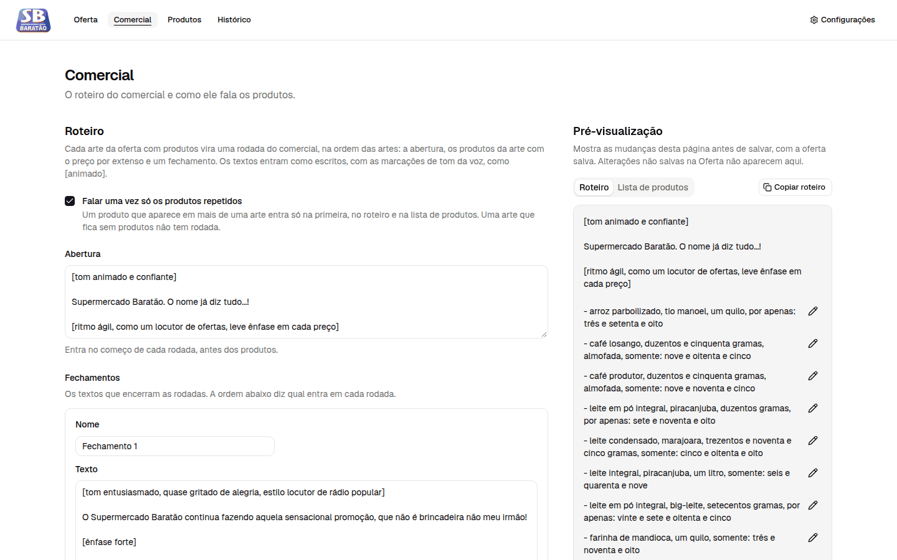

### Como o roteiro é montado

Cada arte com produtos vira uma **rodada** do comercial, na ordem das artes: a **Abertura**, os produtos da arte com o preço por extenso e um **fechamento**. Os textos entram exatamente como você escreve, inclusive as marcações de tom para o serviço de voz, como `[animado]`.

- **Falar uma vez só os produtos repetidos:** um produto que aparece em mais de uma arte entra só na primeira.
- **Abertura:** o texto do começo de cada rodada.
- **Fechamentos:** os textos que encerram as rodadas. Dê um nome a cada um.
- **Ordem dos fechamentos:** o **Fim** entra sempre, o **Começo** entra nas primeiras rodadas e o **Meio** se repete no resto. A tabela abaixo mostra quais fechamentos entram conforme o número de artes, então o mesmo roteiro serve para uma oferta de qualquer tamanho.
- **Antes de cada preço:** as expressões que vão antes do preço, uma por linha, usadas em sequência ("por apenas", "somente"…).

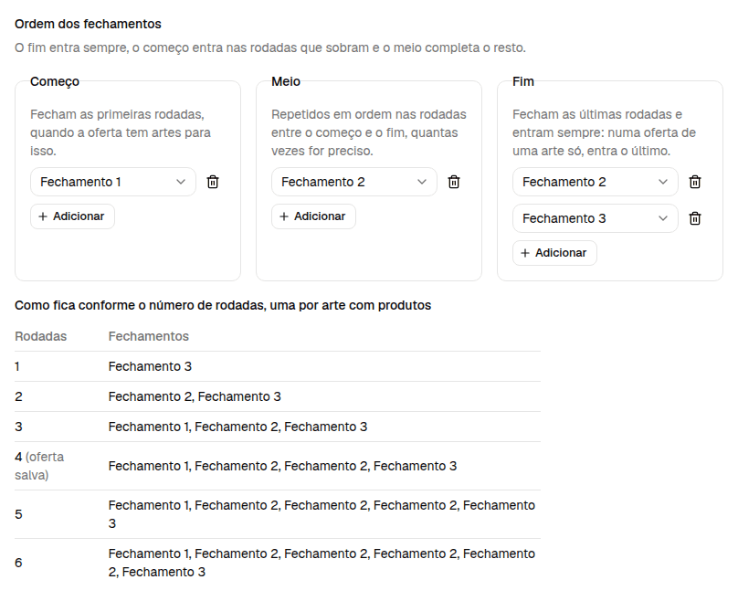

### Como a voz fala os produtos

Cada produto é falado pelo **Texto da locução** do seu cadastro ou, quando ele está vazio, por uma sugestão: a descrição e a unidade em minúsculas, com números e medidas por extenso ("café pilão, duzentos e cinquenta gramas").

Se a voz lê alguma palavra errado, ensine a pronúncia no **Dicionário de pronúncia**: o **Termo** como está escrito e **Como falar**. Ele vale para a sugestão de todos os produtos.

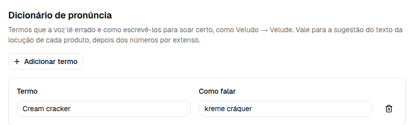

Para ajustar um produto só, clique no lápis ao lado dele na pré-visualização. A mudança fica salva no cadastro do produto na hora.

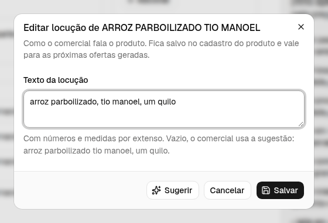

Clique em **Salvar** para guardar o roteiro e o dicionário. As ofertas geradas a partir daí usam o texto novo; as que já estão no histórico continuam como foram geradas.

## 7. A oferta da semana seguinte

Não é preciso montar tudo de novo: a oferta da semana seguinte começa da atual.

- **Limpar preços de todas as artes:** mantém os produtos e apaga os preços e a validade. Bom quando os produtos se repetem.
- **Limpar produtos de todas as artes:** esvazia todas as artes e apaga a validade. As artes, os modelos e os textos do destaque continuam.
- **Limpar produtos da arte**, nos botões de cada arte, esvazia só a arte aberta.

A janela de confirmação diz quantas artes e produtos são afetados. Nada muda de vez até você clicar em **Salvar**, e **Voltar à versão anterior** desfaz um salvamento por engano.

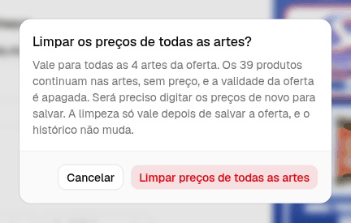

Para reaproveitar uma arte de uma semana anterior (a do açougue, por exemplo), use **Copiar artes** no **Histórico**. Marque as artes que quer e confirme: elas entram no fim da oferta atual, com os produtos e os preços. Um produto que a oferta atual já tem mantém o preço de lá.

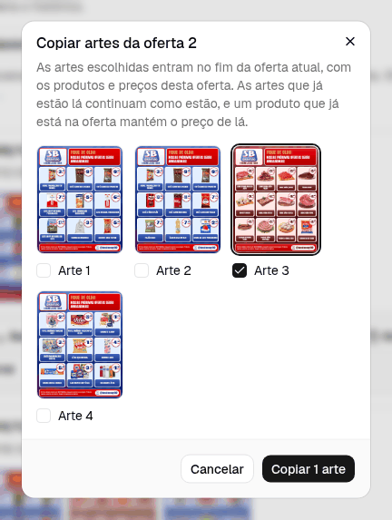

## Configurações

### Marca

Em **Configurações** → **Marca**, você muda o nome, o slogan, o Instagram, o logo e os modelos de cores, com a mesma tela da [primeira configuração](#1-primeira-configuração). Clique em **Salvar** no fim. As ofertas já geradas não mudam.

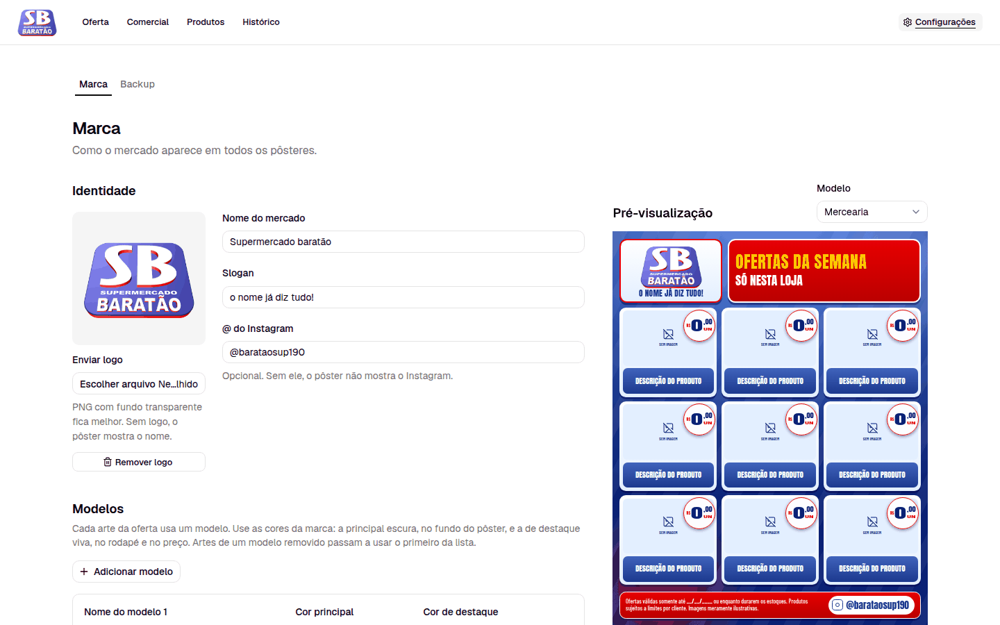

### Backup

Em **Configurações** → **Backup**, **Baixar backup** baixa num único `.zip` tudo o que o mercado cadastrou: produtos e fotos, oferta, marca e logo, comercial e histórico. Guarde uma cópia fora do computador do app.

**Restaurar backup** substitui todos os dados do app pelos de um backup. Antes de aplicar, o app mostra o que muda:

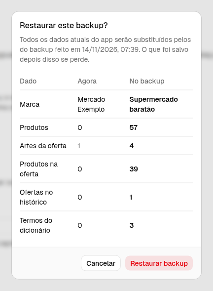

O passo a passo, inclusive como fazer o backup pelo terminal quando o app não abre, está no [guia de backup](./backup.md).

## Dicas

- **Leitor de código de barras:** todo campo de código aceita o leitor. Ele "digita" o código e aperta Enter, e o app já busca o produto.
- **Vários computadores:** o app pode ser aberto em qualquer computador da rede do mercado (veja a [instalação](./instalacao.md)). Todos veem os mesmos dados, mas evite editar a oferta em dois lugares ao mesmo tempo: o último a salvar substitui o outro.
- **Sem internet:** depois de instalado, o app funciona só com a rede do mercado. Nada é enviado para fora dele.
- **Antes de atualizar:** faça um backup e siga o [guia de atualização](./atualizacao.md).
